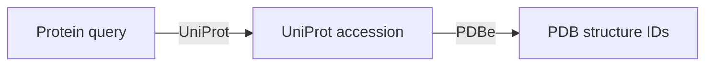

# How Braidworks fits together

Braidworks separates the description of a lookup from the source code that performs
it. A source declares its input and output types; core uses those declarations to
plan and execute a query. Biological interpretation remains in each weaver.

This page explains the system for contributors and application developers. For
operating instructions, start with [usage](usage.md); for implementation rules, use
[core contracts](core-contracts.md).

## From a question to a result

Consider a query asking for experimental structure IDs from a protein query:

The planner can find this route because UniProt declares that it produces
`protein.uniprot.accession` and PDBe declares that it consumes that same type.
A type identifies the meaning of a value; matching type names make lookups connect.

Planning uses declarations and available input types, without fetching source data.
Execution supplies the actual values, makes the source calls, and records the
observations and outcomes. A route establishes that a lookup is possible; it does
not establish that every input will match or that a provider is currently reachable.

## The pieces and their responsibilities

| Piece | Responsibility |
|---|---|
| `Strand` | A typed value with confidence, provenance, and metadata |
| `StrandSet` | Values and execution context for one input or expanded child |
| `Capability` | An operation's inputs, outputs, output groups, backends, and parameters |
| `WeaverManifest` | A source adapter's version, capabilities, and provenance declaration |
| `BraidRegistry` | Registered weavers and the graph built from their declarations |
| `Braider` / `Braid` | Route planning and the serializable plan it returns |
| `LocalExecutor` | Batched execution, expansion, review, fallback, and result assembly |
| `ExecutionResult` | Terminal entities, review context, branch diagnostics, and truncations |

The CLI and `fetch` discover installed weavers through entry points. Applications
can register explicitly configured builders instead. Discovery can inventory a local
backend even when its reference data are absent; acquisition is a separate choice.
See [source setup](sources.md) and [weaver configuration](weaver-configuration.md).

## Planning and execution

The registry preserves alternative sources as parallel graph edges. The braider
finds minimum-cost routes to requested outputs, combines common steps, and orders
them by dependency. Single-input capabilities and `consumes_any` alternatives are
routable. Capabilities requiring several inputs together remain declared but are
not projected into the type graph as ordinary edges.

Backend policies restrict eligible routes and set the preferred/fallback backend
within a capability. `LOCAL_FIRST` prefers local within a chosen capability; it does
not force a more expensive local route over a cheaper API route. Planning uses
advertised backends, so runtime configuration can still prevent execution.

`Braid.waves()` groups independent steps. The executor runs steps in a wave
concurrently and waits before running dependent waves. It chunks batches according
to the capability limit and each backend uses upstream bulk calls where supported.
HTTP pacing counts requests separately from identifiers and concurrency.

Per-entity misses and technical errors are recorded. Independent branches retain
successful data, and rerouting can try another declared path to missing targets.
Structural failures such as invalid configuration or a broken batch contract abort
the run. A resolved entity may still have missing fields or branch errors; see
[result semantics](results.md).

## Collections and review

A capability declares `set_outputs` for related identifiers that can feed another
lookup. Expansion creates child contexts per selected member, carrying their original
source row and parent label. One run-wide budget bounds additional leaves. Source
display lists may be capped while the join-key set retains the distinct IDs the
source actually returned. This is not a guarantee of upstream completeness.

Ambiguous resolver candidates pause by default. Automatic selection requires an
explicit review policy and retains review flags. Expansion and minimum-confidence
controls do not replace human review; confidence scores are source-specific heuristics.
Some lookups, such as UniProt symbol search, return a representative rather than a
resolver candidate set. The capability's semantics matter to interpretation.

## Source adapters and assembly

A scaffolded weaver is small: its generated vocabulary declares the manifest, source
backends fetch neutral records, and shared core mapping turns those records into
`WeaveResult` objects. `BackendDispatchWeaver` supplies shared dispatch and lifecycle.
NCBI keeps its custom records and plumbing for its richer taxonomic behavior.

The source builder assembles those adapters. Core's `WeaverFactory` dispatches to
registered `WeaverProvider` implementations without knowing biological details.
This keeps construction options in the source package and orchestration in core.
Use the [spec/scaffold loop](../CONTRIBUTING.md) to add a weaver rather than copying
another source's internal machinery.

## Saved observations and progress

A cache answers whether an existing observation can satisfy a lookup. Its key
includes input values, effective parameters, weaver version, backend, and source
fingerprint; requested output-group coverage is checked separately. API fingerprints
may describe an interface rather than a frozen data release.

Execution uses memory by default. Optional SQLite lookup caches reuse observations
across invocations. A separate run store keeps query state and review decisions;
observation archives export the run for inspection. The three have distinct roles
and persistence is enabled only with explicit paths. See [persistence](persistence.md)
for freshness, continuation, leases, and retention rules.

## Package boundaries

- **`braidworks-core`** owns domain-neutral data, planning, execution, query services,
  persistence protocols/implementations, discovery, and the query CLI.
- **`weavers/*`** own provider-specific APIs, local data, identifiers, and interpretation.
- **`weaverkit`** owns spec validation, scaffolding, conformance checks, catalogues,
  network visualization, and the optional browser server.
- **`braidworks-arq`** adapts execution to an experimental Redis/arq worker system;
  a local test pass does not certify a deployed fleet.

See [repository structure](repo-structure.md) to locate code. Framework invariants
and source contracts are documented in [core contracts](core-contracts.md) and
[AGENTS.md](../AGENTS.md). Historical roadmaps describe proposals at their recorded
dates; [history](history.md) keeps them separate from current behavior.
