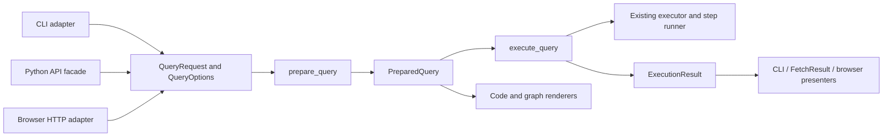

# Application refactor plan, excluding persistence

Implementation contracts and integrated work order: [three-round programme](../refactoring/README.md).
Tracking: [#145](https://github.com/rafaelmdc/braidworks/issues/145).
Related [audit/spec](application-patterns.spec.md). Status: planning only.
The persistence plan and #143 retain ownership of connections, caches, checkpoints
and resume; this plan owns application boundaries above the existing executor.
Work stays on `refactor/persistence-foundations`, with local commits and no push.

## Target flow

Presentation adapters consume prepared plans and results. Core imports neither
weaverkit nor FastAPI. Renderers do not perform source I/O. Direct weaver/executor
APIs remain available and retain their contracts.

## A1 — Normalize application requests (N02)

Proposed module: `braidworks.core.query` initially; split only when responsibilities
justify it. Define frozen dataclasses with JSON round trips:

- `QueryOptions`: backend, expansion, review, confidence and budget settings in their
  existing core types; effective/defaulted parameters belong to preparation.
- `QueryRequest`: already parsed StrandSets, target types, optional traversal tokens
  and supplied parameters. Preserve input order/source_row/duplicates. Copy caller
  input state when needed so preparation does not mutate it.
- `PreparedQuery`: validated options, grouped inputs and executable plans, relevant
  capabilities/effective parameters, resolved traversals and a stable preview value.
  Runtime registry/runner handles need not be serialized as part of this value.

Start with routed and traversed queries. Direct CLI `run` can retain its separate
capability-call path until the exact direct-mode semantics are characterized; do not
force it through a planner or hide the distinction in optional arguments.

CLI and browser normalize their current expansion syntax and defaults into QueryOptions.
Pydantic stays an optional transport dependency. Parameter parsing adapts to existing
`core.parameters`; no duplicate coercion/validation implementation.

Gate: typed values, all valid/invalid expansion modes, defaults and route scopes agree
across adapters before source I/O. Preserve legacy public signatures as wrappers.

## A2 — Extract query preparation and execution (N01)

Add `prepare_query(registry, request) -> PreparedQuery` and
`async execute_query(registry, prepared, *, executor=None, on_event=None) -> ExecutionResult`.
Preparation validates every heterogeneous group before calls begin. Execution owns
one shared expansion budget and deterministic result/reference aggregation. Use the
existing traversal/executor behavior, not a parallel engine. Provide one aggregation
helper with explicit identity/reference rules rather than duplicated bucket loops.

Move orchestration from CLI `_cmd_weave`, serve `execute_batch_response` and relevant
single/traversed helpers into this service. Existing serve helpers become thin
compatibility wrappers translating results. `async_fetch` becomes a convenience
facade over the same service and retains its documented unique-ID/dictionary behavior.
Sync wrappers alone own `asyncio.run`; the service is always async when doing I/O.

Keep output, summaries, archives and exit-code policy in the CLI adapter. This stage
must not move persistence logic into the service or alter resume/checkpoint ownership.

Gate: mixed terminal outcomes, duplicate rows, heterogeneous groups, traversal,
parameters/defaults, confidence/review, backend policy, expansion bounds and reroute
references retain existing behavior through every adapter. Extend meaningful parity
regressions without weakening the existing contract tests.

## A3 — Prepared-query presentation and code generation (N03)

Proposed module: `weaverkit/codegen.py`; preserve `serve.code_response` wrappers.
Functions `render_cli(prepared, input_spec)` and `render_python(prepared, input_spec)`
consume the same request/settings representation. Table/file/stdin input is a rendering
concern; raw text and quoting remain explicit. One shell-token function handles shared
flags. Generated Python calls core's query service, not `weaverkit.serve`.

Allow `view.build_path` to render an already planned Braid while preserving its
existing plan-and-render convenience entry point. Browser graph classification and
key metadata stay in weaverkit. Result presenters consume shared terminal records
from outcomes.py; human labels do not belong in the executor.

Gate: execute generated Python and actual CLI commands against deterministic fixtures,
including multi-input, parameters, review, expansion and traversal. Ensure rendering
uses the prepared plans instead of silently replanning. Keep legacy artifact response
keys/envelopes until clients can migrate.

## A4 — Transport and stream adapters (N04, part of N08)

Proposed module: `weaverkit/streaming.py`, optional server integration only.
One async stream helper owns the execution task, optional progress queue and terminal
result/error translation. GET and POST handlers decode their inputs, normalize the
request, then delegate. Always cancel and join owned work on disconnect. Bound or
coalesce nonterminal progress without dropping completion/errors. Preserve public SSE
fields and endpoint compatibility; make HTTP status changes a separate deliberate API
change if current clients depend on `{ok:false}` responses.

Use a small presenter function for expected domain failures at each interface, not
one generic exception decorator swallowing every error. Unexpected failures retain
traceback/logging context. The core service raises domain errors or returns existing
result values; it does not decide HTTP responses or process exit codes.

Gate: both stream endpoints, malformed inputs, disconnect before/during execution,
completion ordering, slow consumers, cancellation and retry. Existing Firefox journey
checks complement transport tests; avoid pretending mocked SSE certifies browser behavior.

## A5 — One browser request encoder (N05)

Extend `experimentState()` rather than adding a new competing store. Extract a pure
`normalizeExperiment(state)` / `toQueryRequest(state)` pair for typed and graph modes.
Run, code generation, preview and recipe save/load call it. Rendered controls update
experiment values; animation/current result state remains separate.

If extracting source files, keep distribution/static HTML self-contained: concatenate
or embed the plain JS modules at render time, without a required frontend build tool.
No new UI framework. Preserve keyboard navigation, modal focus and offline network views.

Gate: identical experiments yield equivalent request bodies from both builders;
`auto` expansion normalizes predictably; recipe roundtrip preserves batches/options;
file upload, cancellation, code generation and exports pass real-browser journeys.

## A6 — Pure scaffold generation and safe publication (N06)

Retain public `scaffold(spec, dest, ...)`. Internally split:

1. Build an artifact plan with relative paths and typed rendering context.
2. Render templates exactly once with target-language escaping.
3. Validate required bindings, Python syntax and conflicts.
4. Publish generated files under the destination; optionally format afterward.

Templates can move to `weaverkit/templates/` if package-artifact tests prove they are
included in wheels/sdists. A separate templating dependency is unnecessary unless
measured complexity warrants it. Keep `_vocab_source` compatibility until callers
migrate. Never regenerate handwritten NCBI vocab. `--force` must remain explicit;
validate before overwriting existing implementation files, and document that filesystem
publication is not a full multi-file transaction unless implemented as such.

Gate: literal placeholder text in spec values is preserved, quotes/newlines render
valid Python/TOML, missing tokens fail, generated variants import, fixtures/conformance
remain deterministic, and installed-wheel scaffolding works. Do not alter tests to
permit unsafe template output.

## A7 — Small discovery and retry-policy seams (N07, N08)

Core discovery returns a structured registry/report, with strict/tolerant policy and
pre-import `only` filtering. Preserve current strict helper and tolerant visualizer
wrappers; arq retains worker-local registry lifetime. Do not add process-wide service
locators. Keep structured failure details until presentation.

Arq gets a small tested retry-decision function, with explicit transient vs structural
classification. Preserve backoff limits/jitter and source-specific result-value fallback.
Do not retry UnsupportedCapability or programmer errors merely because they are
Exceptions; classify deliberately. Coordinate broad error taxonomy with #133, separate
from this bounded refactor. No required transport-library dependency in core.

Gate: excluded plugins are never imported; partial visualizer discovery reports failures;
strict discovery still fails; transient retries and nonretryable failures follow the
agreed table. No deployed-fleet claims from inline tests.

## A8 — Optional NCBI runtime adaptation (N09)

Evaluate last. Compare source-local dispatch behavior with core dispatch capability by
capability. Normalize only compatible record paths through a source-local adapter.
Keep taxonomy-specific candidate mapping and explicit custom behavior. Reject this
extraction if it requires broadening core records or subclass hooks for one source.
It is an opportunity, not an acceptance requirement to make all weavers identical.

Gate: NCBI direct/routed, taxonomy/lookup, batch order, failures, requested groups and
parameters retain contract/golden behavior. Live tests are mandatory if API backend
behavior changes. No reference-data download for this refactor.

## Commit order and review boundary

A1+A2 first: shared request and execution responsibility. Then A3 and A4, followed by
A5. A6 and A7 are independent after their own characterization; A8 remains conditional.
Use one issue for this scoped design, linked to existing audit issues #138/#141/#139
and error-system #133. Make local commits per coherent step and retain compatibility.

Coordinate with persistence work: this plan owns application request preparation and
presentation; persistence design owns executor state transitions and durable storage.
Both reuse LocalExecutor/WeaveStepRunner. There is one executor, not one per interface.

Required checks: relevant package suites and meaningful parity tests, then workspace
lint/test and built-artifact checks after public/module changes. No new dependency or
framework should enter solely to satisfy a named pattern. Public API/behavior changes
need coherent independent package versions and core floors.
