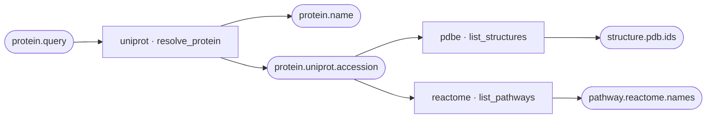

# How routes are planned

When you ask the browser, the command line or Python for fields, Braidworks first
works out which sources to call and in what order. This page explains how that route
is found, what the **Explore sources** graph shows, and why some fields are out of
reach. For the general architecture see [how Braidworks fits together](architecture.md);
for a hands-on start, [your first query in the browser](../tutorials/first-query-in-the-browser.md).

## Sources declare what they connect

Every installed source (a *weaver*) declares its capabilities: what each one takes and
what it gives, named by fields such as `protein.query` or `structure.pdb.ids`. UniProt's
`resolve_protein` takes a `protein.query` and gives a `protein.name` and a
`protein.uniprot.accession`; PDBe's `list_structures` takes a `protein.uniprot.accession`
and gives `structure.pdb.ids`.

Because both name the same field, `protein.uniprot.accession`, the output of one can
feed the other. Nothing else links them: no source knows about any other. A field that
several sources produce or consume is a *shared key*, and shared keys are what make a
network out of separate sources.

**Explore sources** draws exactly this: shared keys as nodes, each source capability as
an operation between them, and fields that only one capability returns on that
capability's card. It is built from the declarations alone, without calling any source.

## Finding the cheapest route

To plan a query, Braidworks turns the declarations into a directed graph from field to
field. Each capability contributes one edge from each field it takes to each field it
gives, carrying a declared cost (1 unless the source says otherwise). Two sources that
can produce the same field are two parallel edges; nothing is merged away.

For each field you want that your inputs do not already contain, the planner finds the
cheapest path from the fields you have (Dijkstra's shortest-path algorithm, ties broken
by source and capability name so the same question always gets the same route). It then
merges the paths: a capability used by several of your fields runs once and returns
them all. In the example above, asking for name, structures and pathways gives one
UniProt step feeding both PDBe and Reactome, not three UniProt calls.

The merged steps are ordered so each one runs after the steps that produce its input,
and grouped into *waves* of steps that do not depend on each other. Within a wave the
steps run concurrently; PDBe and Reactome above run side by side once UniProt has
answered. Each step receives the whole batch of inputs at once, so a hundred IDs become
a few bulk requests, not a hundred.

**How this was answered**, beside the browser's results, shows the route that ran,
step by step, with how many rows each step found, did not match, skipped or failed.

## What the backend setting changes

Many capabilities can answer from a local database, a web API, or both. The *backend
policy* (Advanced settings in the browser, `--policy` on the command line) works in two
places. First it removes capabilities that offer none of the allowed backends, so
"local data only" can make a field unreachable that an API would reach. Then, within
each chosen capability, it sets which backend to try first and which to fall back to.
"Local data first" does not force a longer local route over a shorter API one: it
prefers local within the route the costs chose.

## Why a field can be out of reach

A field is greyed out in the browser, or the command line reports "no route", when no
chain of declared capabilities leads from your input to it. The usual reasons:

- **No source produces it from anything you can reach.** The field belongs to a source
  that starts from a different kind of input, such as an organism name when you have a
  gene symbol.
- **The backend policy excluded the only route,** for example "local data only" when
  that source has no local database configured.
- **The capability needs several inputs together.** Capabilities that require two
  fields at once stay declared but are not used for routing, because one input alone
  cannot start them.
- **The source is not installed.** The no-route message names the missing source when
  the repository has one that would answer, and [the key index](../reference/keys-index.md)
  lists every field across all sources.

A route only shows that a lookup is *possible*. Whether an input matches, and whether a
provider is reachable today, is learned when the route runs; see
[what a lookup result establishes](result-meaning.md).

## When a step fails or returns a list

If a step fails during a run, Braidworks plans again with that capability excluded and
tries another declared path to the fields still missing. The route panel counts these
as "rerouted after a failure", and the original error stays in the result.

Some capabilities return a list where a later step needs one value: a protein's many
PDB structures, when you ask for each structure's title. By default the later step uses
the list's first member and says so in a warning. **Lists in later steps** (Advanced
settings, or `--expand` on the command line) can follow every member, or the first few,
as separate child rows instead. A list you ask for directly always comes back whole on
one row.

Following a relationship that returns the same kind of entity, such as every ortholog of
a gene, is not something the planner infers: you name it as a pass-through step in
**Explore sources** or with `--for-each` on the command line, and the route is planned
from each result.
